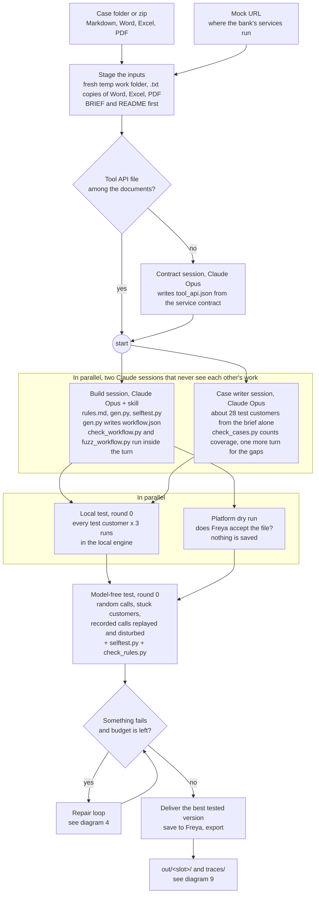
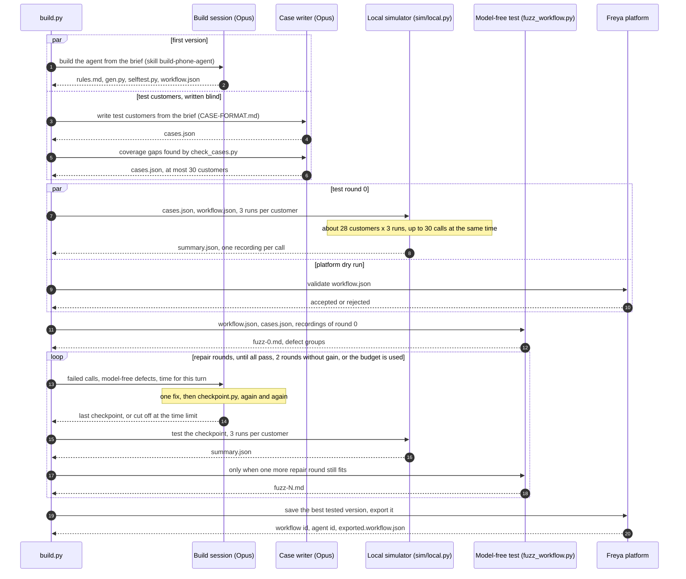
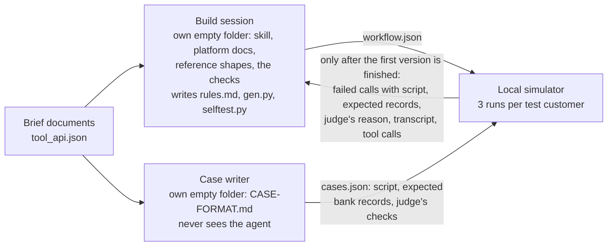
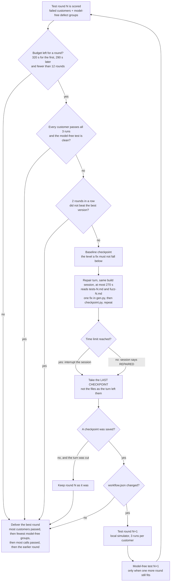
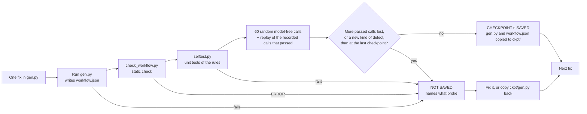
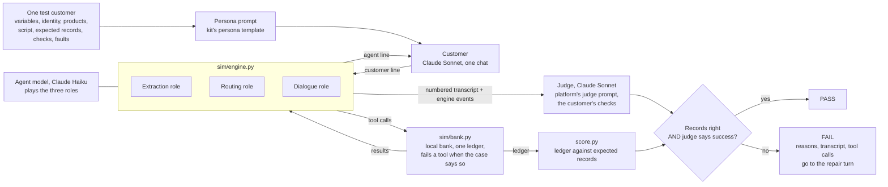
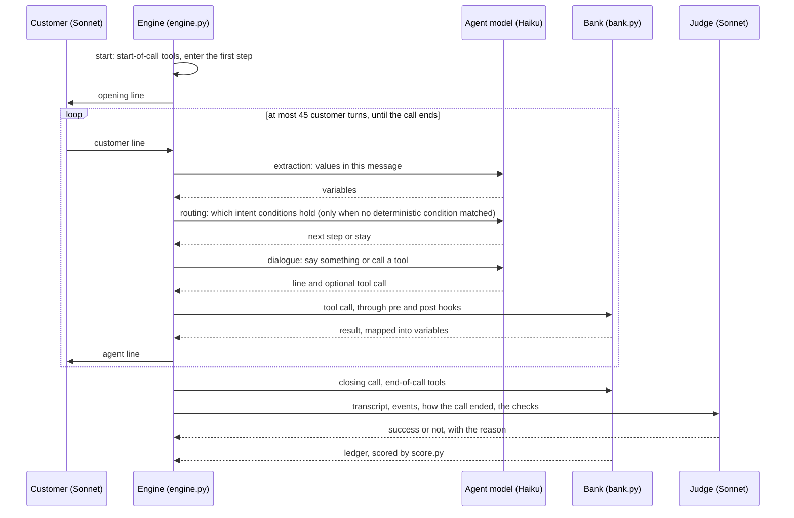
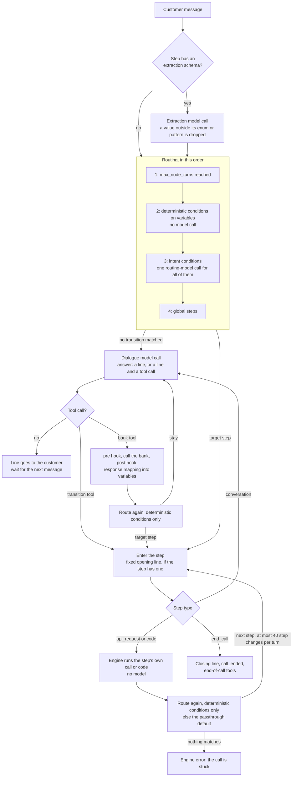
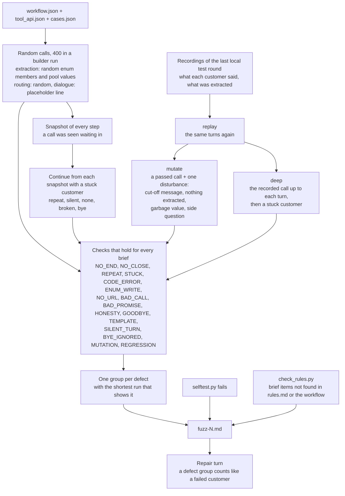
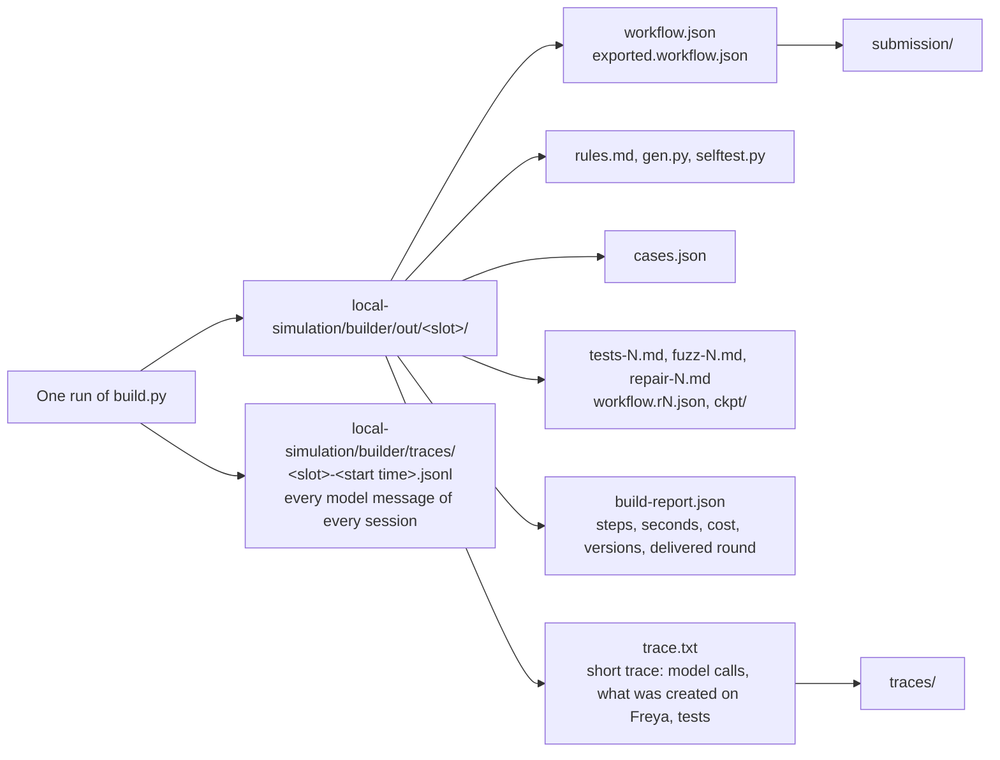

# How the builder works

Diagrams of one builder run, of what runs in parallel inside it, of the repair loop, and of the local simulation engine the
builder tests its own agent in. The text of each step is in [README.md](README.md); this page shows how the pieces connect.

Each diagram names the source file it describes. When that file's structure changes, the diagram changes in the same commit
(see [Keeping this page current](#keeping-this-page-current)).

- [1. One run, end to end](#1-one-run-end-to-end)
- [2. What runs in parallel](#2-what-runs-in-parallel)
- [3. Who sees what](#3-who-sees-what)
- [4. The repair loop](#4-the-repair-loop)
- [5. One checkpoint](#5-one-checkpoint)
- [6. The local simulation: one test call](#6-the-local-simulation-one-test-call)
- [7. The local engine: one customer turn](#7-the-local-engine-one-customer-turn)
- [8. The model-free test](#8-the-model-free-test)
- [9. What comes out](#9-what-comes-out)

## 1. One run, end to end

`python3 local-simulation/builder/build.py {case_folder} {mock_url}` is the only command. Everything below happens inside that
one process (`build.py`, class `Run`, method `main`).

Without `ANTHROPIC_API_KEY` the case writer, the tests and the repair loop are skipped and the first version is delivered.

## 2. What runs in parallel

Three levels of parallelism, all inside the one process (`asyncio`): two Claude sessions at the start, the test round next to
the platform dry run, and inside a test round every call of every test customer at once.

The build session is one long conversation: the repair turns go to the same session that wrote the generator, so it still
knows why each rule is built the way it is.

## 3. Who sees what

The test customers are only worth something when they are written without the agent in view, and the agent without the test
customers in view. Each session works in its own empty temp folder.

Nothing of an earlier run or of another brief is in either folder, so a session cannot start from an old generator.

## 4. The repair loop

`build.py`, the `while` loop in `main`. A repair turn is short (at most 270 s) because a re-test tells more than a longer
turn. The loop has no fixed number of rounds; it ends on one of the exits below.

Every tested version is kept as `workflow.r<N>.json`, so a repair that made things worse costs nothing: the earlier round is
delivered.

## 5. One checkpoint

`checkpoint.py`. The build session runs it after every single fix. No model takes part; it takes some seconds. What is tested
and delivered after a repair turn is the last saved checkpoint.

## 6. The local simulation: one test call

`sim/local.py`. Nothing on Freya is touched: the workflow file runs in a local copy of the platform's engine against a local
bank. The customer and the judge use the platform's own prompts (`prompts/`), and the bank's records are scored by the
organisers' scorer (`kit/build-the-builder/tools/score.py`).

A test round runs every customer three times, all calls at once (`--concurrency 30`). A customer counts only when all three
runs pass, the same rule the platform scores by.

The call also ends when the customer has said goodbye and the agent leaves the call open, after two silent agent turns, or at
the turn limit; each of these is a failed ending, as on the platform.

## 7. The local engine: one customer turn

`sim/engine.py`, methods `user`, `route`, `enter`, `dialogue`, `run_tool`. This is the imitation of Freya's engine, written
from the kit's `docs/workflow-format.md` and `docs/tools-and-code.md` and corrected against what was measured on the platform
(code steps run inside a function; a response mapping creates only leaf values, as text, under the step's name).

The three model roles (extraction, routing, dialogue) are the only places a model is called. Everything else is plain Python,
which is what makes the model-free test possible: replace those three calls and a whole call runs in milliseconds.

## 8. The model-free test

`fuzz_workflow.py`. The same engine and bank as in the local simulation, with the three model roles replaced by a random
number generator or by a recording. About a thousand calls in one to two minutes, no model, nothing leaves the machine.

These findings are exact, not a model's opinion: a question asked again without end, a call that never closes, a record the
bank refuses, or bank records that change when one cut-off message is put into a call that passed.

## 9. What comes out

## Keeping this page current

| Diagram | Source |
|---|---|
| 1, 2, 4, 9 | `local-simulation/builder/build.py` |
| 3 | `build.py` (`workdir`, `stage`, `write_cases`) |
| 5 | `local-simulation/builder/checkpoint.py` |
| 6 | `local-simulation/sim/local.py`, `sim/bank.py`, `sim/llm.py`, `prompts/` |
| 7 | `local-simulation/sim/engine.py` |
| 8 | `local-simulation/builder/fuzz_workflow.py`, `check_rules.py` |

A commit that changes the order of the steps, what runs in parallel, an exit of the repair loop, a model, a limit or a number
shown above also changes the diagram.
