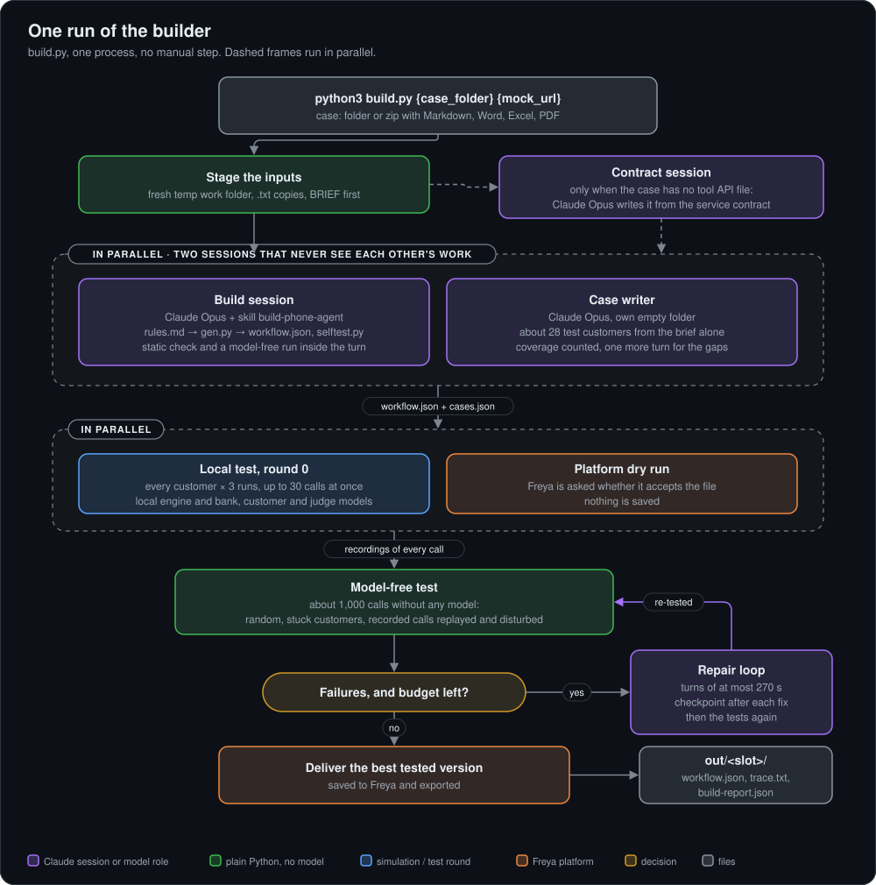
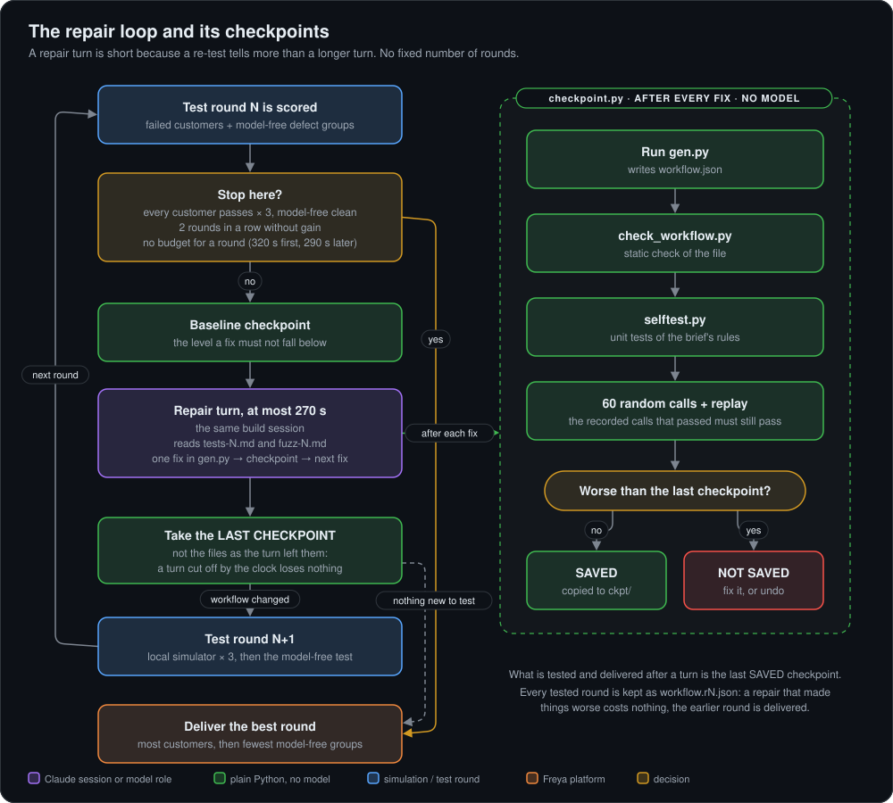
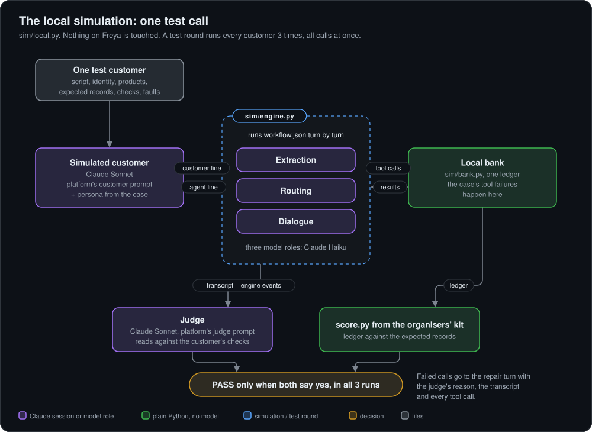
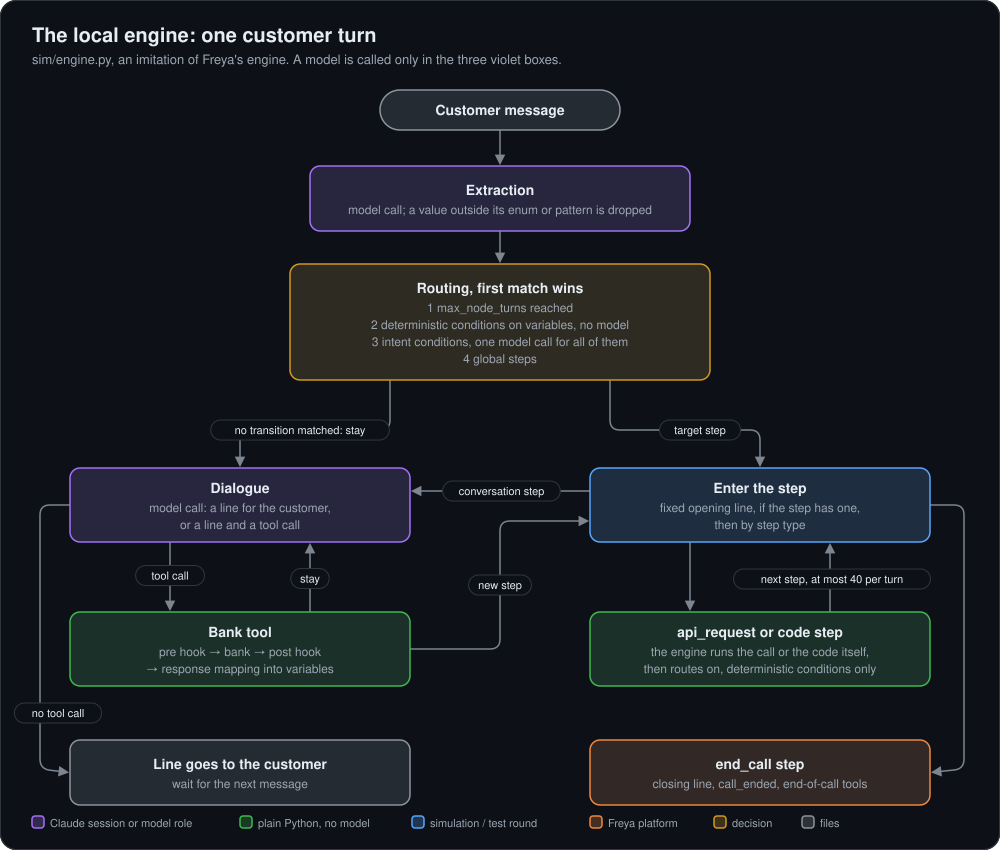
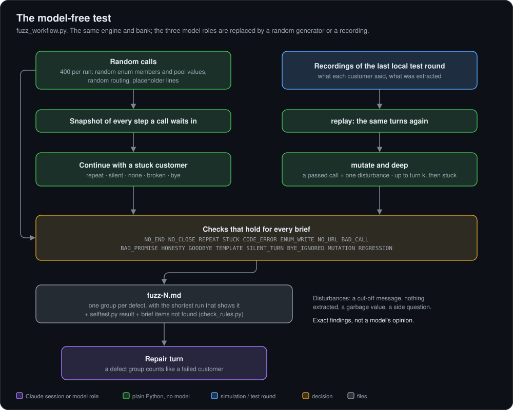

# How the builder works

Five diagrams: one builder run and what runs in parallel inside it, the repair loop, and the local simulation the builder
tests its own agent in. The text of each step is in [README.md](README.md); this page shows how the pieces connect.

Colours mean the same in every diagram: violet is a Claude session or a model role, green is plain Python with no model, blue
is a simulation or test round, orange is the Freya platform, yellow is a decision.

## 1. One run, end to end

`python3 local-simulation/builder/build.py {case_folder} {mock_url}` is the only command. Everything below happens inside that
one process (`build.py`, class `Run`, method `main`).

Three things run in parallel, all inside the one process (`asyncio`):

- **Two Claude sessions at the start.** One builds the agent, the other writes the test customers. Each works in its own empty
  temp folder. The case writer never sees the agent, and the build session sees the test customers only after its first version
  is finished, as failed calls. Test customers written with the agent in view would test nothing.
- **The first test round next to the platform dry run.**
- **Every call of a test round.** About 28 customers, three runs each, up to 30 calls at the same time.

The build session is one long conversation: the repair turns go to the same session that wrote the generator, so it still
knows why each rule is built the way it is. Without `ANTHROPIC_API_KEY` the case writer, the tests and the repair loop are
skipped and the first version is delivered.

## 2. The repair loop and its checkpoints

`build.py` (the `while` loop in `main`) and `checkpoint.py`.

The loop ends when every test customer passes all three runs and the model-free test is clean, when two rounds in a row bring
no gain, or when the budget (60 minutes by default) has no room for another round.

## 3. The local simulation: one test call

`sim/local.py`. The workflow file runs in a local copy of the platform's engine against a local bank. The customer and the
judge use the platform's own prompts (`prompts/`), and the bank's records are scored by the organisers' scorer
(`kit/build-the-builder/tools/score.py`).

A customer counts only when all three runs pass, the same rule the platform scores by. A call that the customer ends with a
goodbye while the agent leaves it open, two silent agent turns, or the turn limit (45) is a failed ending, as on the platform.

## 4. The local engine: one customer turn

`sim/engine.py`, methods `user`, `route`, `enter`, `dialogue`, `run_tool`. It is written from the kit's
`docs/workflow-format.md` and `docs/tools-and-code.md` and corrected against what was measured on the platform (code steps run
inside a function; a response mapping creates only leaf values, under the step's name).

The three model roles are the only places a model is called. Everything else is plain Python, which is what makes the
model-free test possible: replace those three calls and a whole call runs in milliseconds.

## 5. The model-free test

`fuzz_workflow.py`. About a thousand calls in one to two minutes; no model, nothing leaves the machine.

## Keeping this page current

The diagrams are drawn by `diagrams/make.py` (standard library only): one function per diagram, nodes and edges as plain
calls. To change one, edit its function, run `python3 diagrams/make.py`, look at the `.svg`, and commit both.

| Diagram | Source it describes |
|---|---|
| 1 | `local-simulation/builder/build.py` (`main`, `stage`, `contract`, `write_cases`, `test`, `validate`, `fuzz`, `deliver`) |
| 2 | `build.py` (repair loop, `checkpoint`, `take_checkpoint`), `local-simulation/builder/checkpoint.py` |
| 3 | `local-simulation/sim/local.py`, `sim/bank.py`, `sim/llm.py`, `local-simulation/prompts/` |
| 4 | `local-simulation/sim/engine.py` |
| 5 | `local-simulation/builder/fuzz_workflow.py`, `check_rules.py` |

A commit that changes the order of the steps, what runs in parallel, an exit of the repair loop, a model, a limit or a number
shown in a diagram also changes that diagram.
